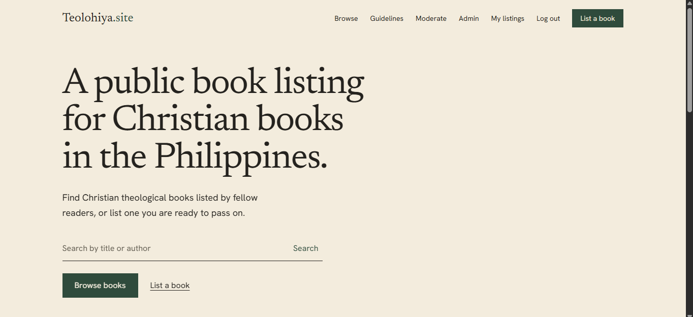
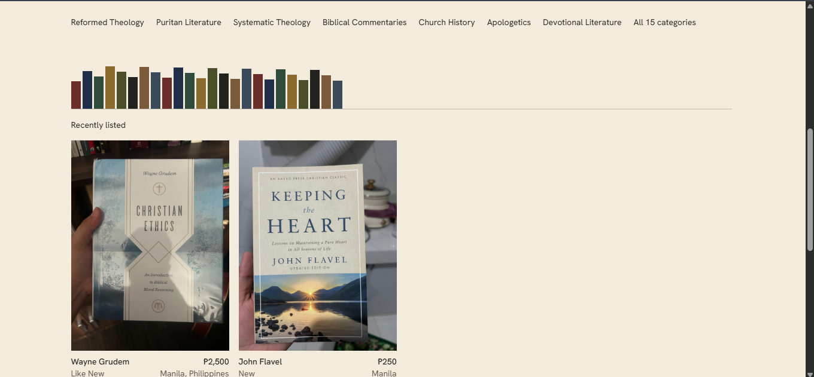
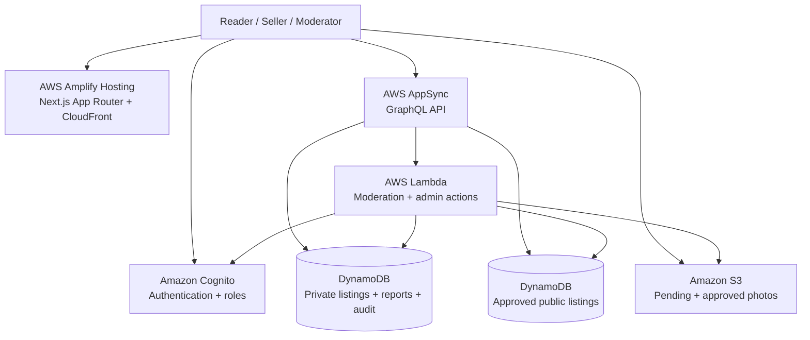
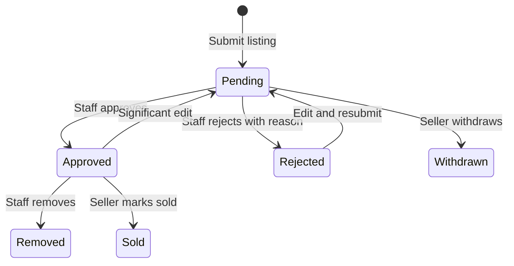

# Teolohiya.site

**Discover and share Christian theological books across the Philippines.**

A live, moderated book-listing platform built with **Next.js, TypeScript, and AWS Amplify Gen 2**.

[**Explore the live site**](https://teolohiya.site) · [**See the architecture**](#architecture) · [**How moderation works**](#moderation--security)

Real screenshots of the live application · <a href="https://teolohiya.site">teolohiya.site</a>

> **Portfolio case study:** The production source code is maintained in a private repository. This repository documents the product, system design, and engineering decisions.

## Why I built it

Christian books in the Philippines are often scattered across marketplaces, social groups, and individual sellers. **Teolohiya.site** brings listings into one searchable place so readers can discover books and contact sellers directly.

This project began as hands-on practice while studying for cloud certifications and grew into a deployed, production-oriented AWS application. **It is a discovery platform, not a checkout service:** payments, delivery, and seller arrangements happen outside the site.

## What it does

| Experience | Capabilities |
| --- | --- |
| **Visitors** | Browse approved books, search and filter listings, view book photos, visit seller profiles, and report listings |
| **Members** | Sign up with Cognito; create and manage listings; upload up to five photos; track review status and resubmit rejected listings |
| **Moderators** | Review pending listings and photos, approve or reject with reasons, handle reports, and remove listings |
| **Admins** | Manage moderator permissions, search users, inspect audit logs, and perform logged administrative reviews |

### Product preview

<table>
<tr>
<td width="50%"></td>
<td width="50%"></td>
</tr>
<tr>
<td align="center">Homepage and search</td>
<td align="center">Categories and recent listings</td>
</tr>
</table>

## Architecture

**Core stack:** Next.js App Router · TypeScript · Tailwind CSS · AWS Amplify Gen 2 · Cognito · AppSync · DynamoDB · Lambda · S3 · CloudFront · CDK/CloudFormation

**Deployment:** AWS Singapore (`ap-southeast-1`), custom domain with managed HTTPS, GitHub-connected Amplify deployment, and AWS Budgets alerts.

## AWS services used

Teolohiya.site is deployed in **AWS Asia Pacific (Singapore), `ap-southeast-1`**, using a serverless architecture. These are the services and infrastructure tools documented in the project:

| AWS service | Role in Teolohiya.site |
| --- | --- |
| **AWS Amplify Hosting (Gen 2)** | Hosts the Next.js application, connects GitHub deployments, and manages the application backend infrastructure. |
| **Amazon CloudFront** | Delivers the hosted website through a content delivery network managed by Amplify. |
| **AWS Certificate Manager (ACM)** | Provides the TLS certificate for HTTPS on the custom domain. |
| **Amazon Cognito** | Handles email sign-in, user identities, moderator/admin groups, and role-based access. |
| **AWS AppSync** | Exposes the GraphQL API used by the frontend for listings and related operations. |
| **Amazon DynamoDB** | Stores private listings, approved public listings, reports, and moderation audit records. |
| **Amazon S3** | Stores uploaded book photos, separating pending images from approved images with scoped access. |
| **AWS Lambda** | Executes trusted moderation and administrative actions, including approval, rejection, and role management. |
| **AWS CloudFormation / AWS CDK** | Defines and deploys Amplify Gen 2 backend resources as infrastructure as code. |
| **AWS Identity and Access Management (IAM)** | Applies least-privilege permissions to application roles and deployment access. |
| **AWS IAM Identity Center** | Supports SSO-based AWS access without relying on long-lived user access keys. |
| **AWS Budgets** | Provides cost alerts and spending visibility for the AWS account. |

### How the services work together

1. **Amplify Hosting and CloudFront** serve the Next.js website over HTTPS using an **ACM** certificate.
2. **Cognito** authenticates users and establishes permissions through groups and **IAM** roles.
3. The frontend accesses listing data through **AppSync**, backed by **DynamoDB**.
4. Sellers upload images to **S3** under restricted paths; **Lambda** handles approval and publishing workflows.
5. **CDK / CloudFormation** manage infrastructure changes, while **IAM Identity Center** and **AWS Budgets** support secure operations and cost awareness.

> **Architecture note:** AWS Amplify Gen 2 provisions and manages several of these services. They are listed separately to show their distinct roles in the deployed architecture, not to imply each was independently configured from scratch.

## Moderation & security

**Listings are private until approved.** The browser cannot directly approve a listing or write protected moderation fields.

- **Separate private and public data:** only sanitized, approved listings are copied into the guest-readable table.
- **Server-controlled moderation:** Lambda handles approval, rejection, removal, role changes, and audit entries.
- **Role enforcement:** Cognito groups, IAM roles, and live authorization checks protect administrative actions.
- **No moderator self-approval:** admin exceptions are explicitly logged.
- **Concurrency protection:** optimistic locking prevents approval of stale listing revisions.
- **Photo isolation:** private `pending/{identity}/*` uploads and publicly readable `approved/*` images, with scoped permissions and server-side path validation.
- **Abuse controls:** image type and size checks, listing submission limits, and staff-accessible reporting.

## Engineering decisions

| Challenge | Approach |
| --- | --- |
| Prevent unreviewed listings from appearing publicly | Separate `Listing` and `PublicListing` models with Lambda-controlled publication |
| Prevent client-side approval or role escalation | Protected fields, server-side group checks, and scoped IAM permissions |
| Avoid approving outdated content | Version-aware moderation using optimistic locking |
| Ship changes without losing production data | Amplify sandbox testing, guarded releases, and staged schema migrations |
| Keep operating costs proportional to usage | Serverless, usage-based services; no always-on compute or NAT gateway |

**Release discipline:** strict TypeScript, ESLint, production builds, sandbox testing, explicit deployment confirmation, and rollback planning that accounts for database schema changes.

## Lessons learned

- **Authorization spans services.** Cognito group membership alone is not enough; IAM and S3 permissions must match each role.
- **Moderation is a backend concern.** Protected state transitions belong on the server, not in browser-controlled requests.
- **Schema changes need deliberate rollouts.** Reverting an older backend build can be unsafe when newer data models already exist.
- **Small production safeguards matter.** Audit logs, version checks, scoped uploads, and release gates make a real difference.

## Next steps

- Listing view and contact-click metrics
- Branded verification emails with Amazon SES
- Improved indexing and server-rendered book detail pages
- Optional image screening to assist, not replace, manual review

## About the project

Built and maintained by **Jervil Angelo De Leon** as a practical cloud engineering project and a way to help Filipino Christians find and share theological books.

[**Visit Teolohiya.site**](https://teolohiya.site) · [**LinkedIn**](https://www.linkedin.com/in/jervilangelo/) · [**Email**](mailto:deleonangelojervil@gmail.com)

Built for readers. Designed with care. Soli Deo Gloria.

