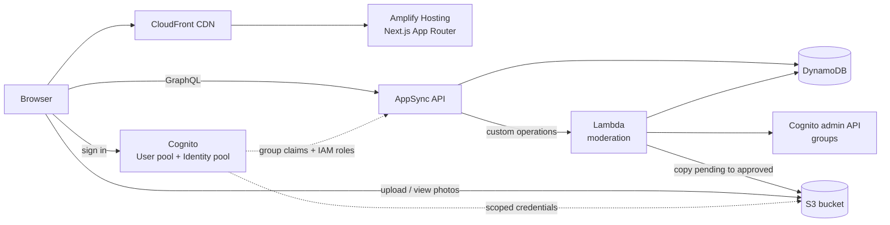
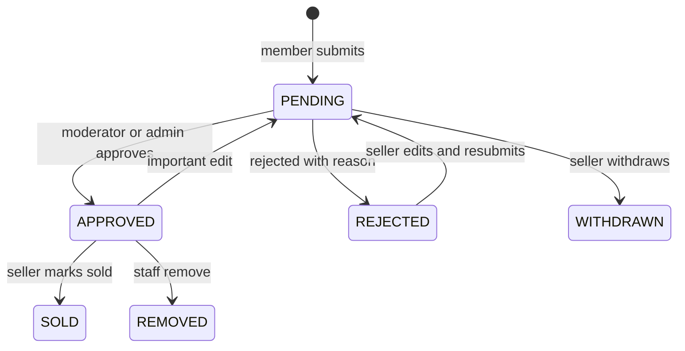

# Teolohiya.site

**A moderated book listing board for Christian theological books in the Philippines.**
Serverless, built entirely on AWS with Amplify Gen 2.

[**Live site → teolohiya.site**](https://teolohiya.site)

Full walkthrough video: <a href="PASTE_VIDEO_LINK_HERE">watch here</a>

> **Note:** The application source lives in a private repository. This repo documents the architecture, AWS services and engineering decisions behind the live site.

---

## What it is

Teolohiya.site is a listing and discovery board, not a store. Members post Christian books they want to sell or trade; visitors browse without signing in and contact sellers directly. There are no payments, checkout, escrow or shipping.

Every listing is **manually reviewed** by an admin or trusted moderator before it becomes public, to keep out spam, fake listings and inappropriate photos.

## Features

| Visitors | Members | Moderators | Admin |
|---|---|---|---|
| Browse and filter approved books | Register and sign in (Cognito) | Review pending queue with photos | Everything moderators can do |
| Photo gallery per listing | Post listings with up to 5 photos | Approve or reject with a reason | Promote and revoke moderators |
| Seller profile pages | See status and rejection reasons | Handle reports | Search users, view audit log |
| Report a listing | Edit, withdraw, resubmit | Remove listings | Approve own listings (logged) |

## Architecture

## AWS services used

| Service | What it does here |
|---|---|
| **AWS Amplify Hosting** | CI/CD from GitHub, SSR hosting for Next.js, custom domain and managed TLS |
| **Amazon CloudFront** | Global CDN in front of the site (managed by Amplify) |
| **AWS Certificate Manager** | HTTPS certificate for teolohiya.site |
| **Amazon Cognito** | User pool (email sign-in), identity pool, `admin` and `moderator` groups, per-group IAM roles |
| **AWS AppSync** | GraphQL API with owner, group and guest authorization rules, field-level auth |
| **Amazon DynamoDB** | Private `Listing` table, public `PublicListing` table, audit log, reports |
| **Amazon S3** | Private `pending/` prefix, public-read `approved/` prefix, scoped per-identity access |
| **AWS Lambda** | Moderation engine: approve, reject, remove, promote, revoke, search users |
| **AWS CloudFormation / CDK** | Amplify Gen 2 defines the whole backend in TypeScript and deploys it as stacks |
| **IAM + IAM Identity Center** | Least-privilege deploy role, SSO instead of long-lived access keys |
| **AWS Budgets** | Spend guardrails on a credit-limited account |

Everything runs in **ap-southeast-1 (Singapore)**.

## Listing lifecycle

## Security design

The key idea: **the browser is never trusted to change a listing's status.**

- **Two-table split.** Pending and rejected content lives only in a private table. Approval copies a sanitized record into a separate public table that guests can read. Pending data is never reachable through public queries.
- **Server-only writes.** Status, reviewer and timestamps are written by Lambda. Clients have read-only access to those fields.
- **Live role checks.** The Lambda re-checks the caller's current Cognito group on every action, not just the token claim.
- **No self-approval.** Moderators cannot approve their own listings. Admin exceptions are allowed and logged.
- **Optimistic locking.** Reviews carry the version the reviewer saw, so a listing edited mid-review can't be approved by mistake.
- **S3 prefix isolation.** `pending/{identity}/*` is private to the uploader and staff. Only `approved/*` is public. Each Cognito group has its own IAM role with explicit storage rules.
- **Upload limits.** Max 5 photos, 5 MB each, image types only, photo paths validated server-side.
- **Rate limits.** Caps on pending listings per user and submissions per day.
- **Audit trail.** Every moderation action is written to a log table only the server can write.
- **Safe role changes.** Promotion and revocation go through Lambda; revoking triggers a global sign-out so old tokens stop working.

## Engineering practices

- Strict TypeScript, ESLint and production build must pass before any release
- Feature branches tested on a personal Amplify **sandbox** before touching production
- Guarded release script: allowed-file checks, type check, lint, build, and a typed confirmation phrase before pushing
- Safe schema changes using expand, migrate, switch, tighten, with a dry-run migration for existing data
- Rollback by reverting the merge commit (never by redeploying an older backend build, which could drop new tables)
- Accessibility: skip link, visible focus rings, reduced-motion support
- SEO: metadata, Open Graph, sitemap, robots, web manifest

## Lessons learned

1. **Cognito groups need IAM, too.** Each group gets its own role; S3 rules for the default authenticated role don't cover admins.
2. **Don't let the client own state transitions.** Moving approval into Lambda removed a whole class of API-tampering risks.
3. **Name collisions bite.** A custom `deleteListing` clashed with the auto-generated model mutation.
4. **Never roll back a data-model change by redeploying an old build.**
5. **CI should use `npm install` when lock files drift across machines.**

## Cost

Designed for near-zero idle cost: Lambda, DynamoDB on-demand, S3 and AppSync are all pay-per-use. Only the custom domain is a fixed cost. No WAF-style add-ons, no always-on servers.

## Roadmap

- Mark as sold, view and contact-click counts
- Branded verification emails via Amazon SES
- Server-rendered listing pages and book URLs in the sitemap
- Optional automated image screening (Amazon Rekognition) behind the manual review

## Author

**Jervil Angelo De Leon**
[LinkedIn](https://www.linkedin.com/in/jervilangelo/) · [deleonangelojervil@gmail.com](mailto:deleonangelojervil@gmail.com)
